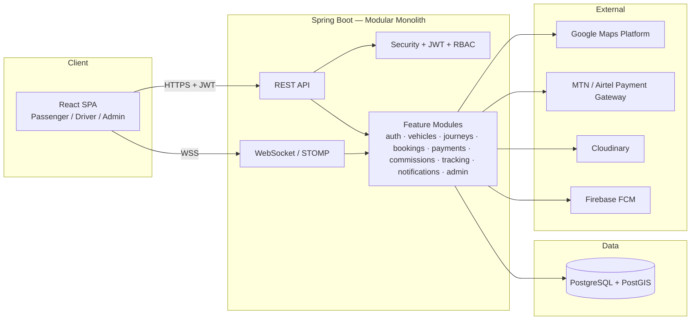
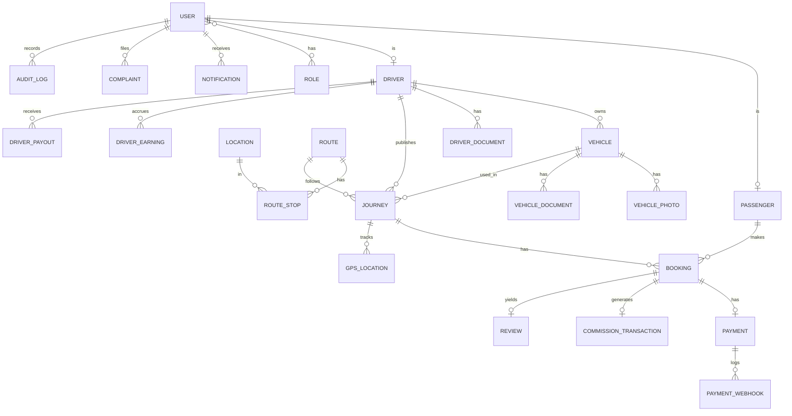

# TEGA PRIVÉ — Architecture & Foundation

> **"YOUR JOURNEY. YOUR FREEDOM."**
> Inter-province transportation & ride-booking marketplace for Rwanda, built to expand across Africa.

This document is the architectural source of truth for TEGA PRIVÉ. It is presented before
implementation per the project brief, and then implementation proceeds in phases.

---

## 1. Vision

TEGA PRIVÉ connects passengers travelling between Rwandan provinces (Kigali ↔ Musanze, Rubavu,
Huye, Nyagatare, Rusizi, Karongi, Muhanga, …) with **verified** independent drivers and vehicle
owners. Passengers search journeys, book seats, pay electronically, track vehicles live, and rate
drivers. Drivers register, submit vehicles for approval, publish journeys, manage seats, and
monitor earnings. The platform owner has full administrative control, including a configurable
commission engine that monetises both sides of the marketplace.

It is a **real marketplace**, not a directory: connected frontend/backend, persistent database,
auth, booking workflows, payments, commission accounting, and real-time tracking.

---

## 2. High-Level Architecture

A **modular monolith**: one Spring Boot deployable, one PostgreSQL database, one React SPA.
Real-time location uses WebSockets (STOMP). No microservices — the brief explicitly forbids
introducing them unnecessarily. The domain is partitioned into feature modules inside the monolith
so it can be split later if scale demands.



### Deployment topology (target)
- **Frontend**: static SPA served by a CDN / Nginx (build output of Vite).
- **Backend**: single Spring Boot JAR behind a reverse proxy (Nginx) with TLS termination.
- **Database**: managed PostgreSQL 15+ with the PostGIS extension.
- **External**: Google Maps, a payment aggregator for MTN/Airtel, Cloudinary, Firebase.

---

## 3. Technology Stack

| Layer | Choice |
|---|---|
| Frontend | React 18 + TypeScript, Vite, Tailwind CSS, React Router, TanStack Query, Axios, React Hook Form, Zod, Lucide React |
| Backend | Java 21 (LTS target) on Spring Boot 3.x, Spring Security, JWT (jjwt), Spring Data JPA/Hibernate, Spring Web MVC, WebSocket/STOMP, Maven |
| Database | PostgreSQL 15+ with PostGIS, Flyway migrations |
| Maps | Google Maps Platform (Routes, Distance Matrix, JS Maps) |
| Payments | Provider abstraction over MTN Mobile Money + Airtel Money via a gateway |
| Media | Cloudinary (vehicle + driver photos, documents) |
| Notifications | In-app now; Firebase Cloud Messaging prepared for mobile |
| Docs | Swagger/OpenAPI (springdoc) |

> **Note on the JDK:** the development machine has JDK 25 installed. The build compiles with
> `--release 21`, so the artefact targets Java 21 bytecode while running on the available JDK.
> Spring Boot 3.x requires Java 17+ minimum and runs on 21/25.

---

## 4. Application Structure (three interfaces)

**A. Public website & passenger portal**
Navbar · hero · destination search · how it works · popular destinations · why us · safety/verification · become-a-driver · FAQ · footer. Passengers can **search journeys without an account**; authentication is required only to complete a booking.

**B. Driver portal**
Profile + verification (identity, licence) · vehicle registration + photos + documents · submit vehicle for approval · publish journeys (only approved vehicles) · manage seats · accept/reject bookings · start/complete journeys · live GPS sharing · earnings & ratings.

**C. Administrator dashboard**
Overview/analytics · passenger mgmt · driver mgmt · driver verification · vehicle mgmt · vehicle approval · journey mgmt · booking mgmt · live monitoring · payment mgmt · commission mgmt · driver earnings/payouts · refunds · complaints · reviews · reports · platform settings. Admins can suspend accounts, approve/reject documents with reasons, and manage inappropriate listings.

---

## 5. Backend Package Layout

Base package: `com.tegaprive`. Feature modules are vertical slices (each holds its
entity/repo/service/dto/controller):

```
com.tegaprive
├── TegaPriveApplication        # @SpringBootApplication entry point
├── common                      # ApiResponse, exceptions, BaseEntity, audit, config helpers
├── config                       # JPA, Flyway, WebSocket, OpenAPI, web, CORS
├── security                     # SecurityFilterChain, JwtProvider, JwtAuthFilter, UserDetailsService
├── auth                        # register/login/refresh/me, DTOs, AuthService
├── users                       # User/Role entities, UserRepository
├── passengers                  # passenger profile
├── drivers                     # driver profile, documents, verification
├── vehicles                    # vehicle, photos, documents, approval
├── journeys                    # journeys, seats/inventory, search
├── bookings                    # booking workflow, seat locking
├── payments                    # provider abstraction, initiation, webhooks, refunds
├── commissions                 # commission rules engine, earnings ledger
├── tracking                    # GPS ingestion via WS, PostGIS, authorisation
├── notifications               # in-app + FCM adapter
├── reviews                     # driver ratings, passenger reviews
├── administration              # admin-only aggregate endpoints
└── reporting                   # analytics, reconciliation
```

---

## 6. Frontend Structure

```
frontend/src
├── assets        # brand assets (logo, hero)
├── components     # reusable UI (Button, Card, Input, Spinner, Badge, SeatPicker…)
├── layouts        # PublicLayout, AuthLayout, PassengerLayout, DriverLayout, AdminLayout
├── pages          # public/*, auth/*, passenger/*, driver/*, admin/*
├── routes         # router config + guards (ProtectedRoute, RoleGuard)
├── services       # api client (axios), endpoint modules
├── hooks          # useAuth, useJourneySearch, query hooks
├── context        # AuthProvider, ThemeProvider
├── types          # shared TS types mirroring backend DTOs
└── validation     # zod schemas
```

---

## 7. Database Design

Normalised PostgreSQL schema. UUIDs for public-facing PKs. Every table carries
`created_at`, `updated_at`; soft-delete where appropriate (`deleted_at` / `deleted` flag).
Money is stored as `numeric(15,2)` (RWF has no minor units). Geographic data uses `geography(Point,4326)`
from PostGIS.

### Core relationships



### Entity notes (key tables)

- **users**: `id uuid pk`, `email` unique, `password_hash`, `first_name`, `last_name`, `phone` unique, `status` (ACTIVE/SUSPENDED/PENDING_VERIFICATION), `created_at`, `updated_at`, `deleted_at`.
- **roles** + **user_roles**: many-to-many. Roles: `SUPER_ADMIN`, `ADMIN`, `DRIVER`, `PASSENGER`.
- **drivers**: FK→users; `licence_number`, `verification_status` (PENDING/APPROVED/REJECTED), `rating_avg`, `is_verified`, `commission_wallet_balance` (for cash bookings).
- **driver_documents**: type (IDENTITY/LICENCE/OTHER), Cloudinary URL, status, rejection_reason, reviewed_by, reviewed_at.
- **vehicles**: FK→driver; make, model, year, colour, `registration_number` unique, category (SEDAN/SUV/VAN/…), `seat_capacity`, `luggage_capacity`, `has_ac`, description, `approval_status` (PENDING/APPROVED/REJECTED), rejection_reason.
- **vehicle_photos** & **vehicle_documents**: multiple per vehicle (ordered photos; documents typed: REGISTRATION/INSURANCE/OTHER).
- **locations**: admin-managed; `name`, `region`, `country`, `geo geography(Point,4326)`, `is_active`. Not hardcoded — admins manage them.
- **routes** + **route_stops**: ordered sequence of locations forming a route template (origin → stops → destination).
- **journeys**: FK→driver, FK→vehicle (must be APPROVED), FK→route; `departure_time`, `estimated_arrival`, `status` (SCHEDULED/ACTIVE/COMPLETED/CANCELLED), `price_per_seat`, `available_seats` (denormalised for fast search, kept consistent via transactional updates).
- **journey_seats / inventory**: seat inventory per journey; `booked_seats` enforced with row-level locking + unique/partial constraints to prevent overbooking.
- **bookings**: FK→journey, FK→passenger; `seats_booked`, `status` (PENDING_PAYMENT, PENDING_DRIVER_APPROVAL, CONFIRMED, CANCELLED, COMPLETED, REFUNDED, EXPIRED), `total_amount`, `expires_at`. Unique constraint to prevent duplicate active bookings.
- **payments**: FK→booking; `provider` (MTN/AIRTEL/CASH), `provider_reference`, `internal_reference` unique, `amount`, `status` (INITIATED/PENDING/SUCCESSFUL/FAILED/REFUNDED), `provider_payload` (jsonb), `verified` boolean (backend-verified only).
- **payment_webhooks**: raw webhook payloads for reconciliation + audit; signature verified.
- **commission_rules**: admin-configured; `driver_commission_pct`, `passenger_service_fee_pct`, `min_fee`, `max_fee`, `fixed_booking_fee`, `cancellation_fee`, `effective_from`. Versioned, never overwritten (append-only history).
- **commission_transactions**: per booking; gross_fare, driver_commission, passenger_fee, processing_charge, driver_net, platform_revenue, settlement_status.
- **driver_earnings**: ledger per completed booking; running balance per driver.
- **driver_payouts**: settlement records (pending → paid via provider / manual).
- **refunds**: FK→booking/payment; amount, reason, status, initiated_by.
- **gps_locations**: FK→journey/driver; `location geography(Point,4326)`, `heading`, `speed`, `recorded_at`, `device`. Partitioning-friendly design for the future RN app.
- **notifications**: FK→user; type, title, body, `read_at`, payload jsonb. FCM integration adapter prepared.
- **reviews**: FK→booking/driver/passenger; rating 1–5, comment, moderation.
- **complaints**: FK→user (complainant) + subject; status, resolution, assigned_to.
- **audit_logs**: actor, action, entity_type, entity_id, before/after jsonb, ip, user_agent. Used for financial + admin actions.
- **platform_settings**: key/value singleton-ish config (e.g., `cash_payments_enabled`, `booking_workflow` = INSTANT | DRIVER_APPROVAL, default commission rule pointer).

### Data integrity guarantees
- Seat inventory uses DB transactions + pessimistic locking (`SELECT ... FOR UPDATE` on the journey row) and a check constraint `booked_seats <= seat_capacity`. Overbooking is impossible at the DB level — the frontend count is never trusted.
- Payments are backend-verified; the booking only advances on a verified webhook/callback.
- Commission figures are computed and persisted server-side; the frontend never decides money.
- Financial ledger keeps **passenger funds, driver earnings, and platform revenue** in clearly separated, auditable flows.

---

## 8. Security Architecture

- **Spring Security** with stateless **JWT** (access + refresh tokens via jjwt). BCrypt password hashing.
- **RBAC** on four roles: `SUPER_ADMIN`, `ADMIN`, `DRIVER`, `PASSENGER`. Method-level (`@PreAuthorize`) + endpoint-level rules. Users access only their own resources.
- **Input validation**: Bean Validation on DTOs at every controller boundary; global exception handler maps violations to `400` with field-level detail.
- **Rate limiting** on sensitive endpoints (login, register, payment callbacks) — bucket-based, configurable.
- **Secure file uploads**: type/size validation; files go to **Cloudinary**, never persisted as local temp files in production. Sensitive driver documents are never served to passengers.
- **Payment webhook verification**: signature/secret verification per provider; idempotent handling via `payment_webhooks` + unique `internal_reference`.
- **Audit logs** for all financial and administrative operations (approvals, suspensions, refunds, commission changes).
- **Secrets**: no API keys/passwords in code or frontend bundles. Everything via environment variables / `.env` (git-ignored).

---

## 9. Payment & Commission Architecture

### Commission engine (server-side, admin-configurable)
For a seat price **P** with driver commission **d%** and passenger service fee **f%**:
- Passenger pays = `P + P·f`
- Driver receives = `P − P·d`
- Platform revenue = `P·f + P·d` (before processing charges)

Example (P=8,000 RWF, d=10%, f=3%): passenger pays 8,240; driver receives 7,200; platform 1,040.
All configurable; rules are **versioned** (effective-dated, append-only). Commission is always
computed and recorded on the backend in `commission_transactions`.

### Payment provider abstraction
A `PaymentProvider` interface (initiate, verify, refund, supports) with adapters for MTN and Airtel.
Adding a new provider = new adapter + config, no booking-system changes. The booking flow depends
only on the abstraction, never on provider specifics.

### Payment lifecycle
initiation → provider reference → backend status verification (never trust frontend) → secure
webhook → reconciliation → idempotent booking advancement. Duplicate payments prevented by unique
references and idempotency keys.

### Driver payouts
Earnings ledger per completed booking; settlement status tracked; payout architecture prepared
for automated provider payouts. We do **not** assume the gateway supports marketplace split
payments — payouts are an explicit, separately-verified settlement step.

### Cash option
Admin-toggled (`platform_settings.cash_payments_enabled`). When enabled, drivers carry a
**commission wallet / prepaid mechanism** with configurable outstanding-balance limits and
account restrictions, so unpaid commissions cannot accumulate indefinitely. Internal wallet
balances are **not** represented as regulated stored-value accounts.

---

## 10. Live GPS Tracking

- Driver starts an active journey → grants location permission → the app collects GPS → posts to the backend over an authenticated WebSocket (STOMP) channel.
- Backend authorises the driver owns the journey, persists `gps_locations` (PostGIS `geography`), and broadcasts to **only** passengers with a valid CONFIRMED booking for that journey (subscription authorisation on the broker).
- Passengers see current location, route, ETA, last-update timestamp, and a **freshness indicator** when GPS updates stop.
- **Privacy**: driver locations are never public; only authorised booking holders receive them.
- **Future-proofing**: a browser may suspend location tracking when the phone is locked. The ingestion endpoint is structured (and versioned) so a future React Native driver app can provide reliable background GPS — the backend treats the source as an authenticated device stream, not a browser-specific one.

---

## 11. External Services & Configuration (environment variables)

All secrets are environment-driven. Example values live in `.env.example` (never in code).

| Service | Variables (backend, `TP_` prefix) |
|---|---|
| Database | `TP_DB_HOST`, `TP_DB_PORT`, `TP_DB_NAME`, `TP_DB_USERNAME`, `TP_DB_PASSWORD` |
| JWT | `TP_JWT_SECRET`, `TP_JWT_ACCESS_EXPIRATION_MIN`, `TP_JWT_REFRESH_EXPIRATION_DAYS` |
| Bootstrap admin | `TP_DEFAULT_ADMIN_EMAIL`, `TP_DEFAULT_ADMIN_PASSWORD` |
| Cloudinary | `TP_CLOUDINARY_CLOUD_NAME`, `TP_CLOUDINARY_API_KEY`, `TP_CLOUDINARY_API_SECRET` |
| Google Maps | `TP_GOOGLE_MAPS_API_KEY` (backend routes/ETA); `VITE_GOOGLE_MAPS_API_KEY` (frontend map) |
| MTN MoMo | `TP_MTN_API_BASE_URL`, `TP_MTN_API_USER`, `TP_MTN_API_KEY`, `TP_MTN_SUBSCRIPTION_KEY`, `TP_MTN_CALLBACK_HOST` |
| Airtel | `TP_AIRTEL_API_BASE_URL`, `TP_AIRTEL_CLIENT_ID`, `TP_AIRTEL_CLIENT_SECRET`, `TP_AIRTEL_CALLBACK_HOST` |
| FCM | `TP_FIREBASE_CREDENTIALS_PATH` (service account JSON) |
| CORS | `TP_CORS_ALLOWED_ORIGINS` |
| Frontend | `VITE_API_BASE_URL` |
> If a service's credentials are not yet supplied, the integration interface + config are built, the
> required credentials are documented, and the provider's sandbox is used where available. The system
> never pretends an integration works when it is unconfigured.

---

## 12. API Organization

RESTful, grouped by domain. Consistent `ApiResponse<T>` envelope (`{ success, data, message, errors }`) and meaningful HTTP codes. OpenAPI via springdoc at `/swagger-ui.html`.

```
/api/auth          register, login, refresh, me
/api/users         current user profile
/api/passengers    passenger profile
/api/drivers       driver profile, documents, verification
/api/vehicles      CRUD, photos, documents, approval
/api/locations     admin-managed destinations
/api/routes        route templates + stops
/api/journeys       publish, search, seat availability, lifecycle
/api/bookings      create, cancel, status, passenger view
/api/payments      initiate, verify, webhook, refunds, history
/api/commissions   rules (admin), calculations
/api/earnings      driver earnings ledger
/api/payouts       driver payouts (admin)
/api/tracking      WS topic + REST freshness
/api/notifications in-app + FCM
/api/reviews       driver ratings
/api/admin         aggregate admin operations
/api/reports       analytics, reconciliation
```

---

## 13. Development Roadmap

| Phase | Deliverables |
|---|---|
| **1. Foundation** *(current)* | Project skeleton (frontend + backend + Maven wrapper); PostgreSQL config + env; Flyway migrations; **JWT auth + RBAC**; initial responsive UI (public homepage + auth pages). |
| **2. Driver & vehicle management** | Driver registration/verification; vehicle registration; photo upload (Cloudinary); vehicle approval workflow. |
| **3. Journeys & booking** | Location/route management; journey publishing (approved vehicles only); search; seat inventory with overbooking protection; booking workflow. |
| **4. Payments & commission** | Provider abstraction; MTN/Airtel sandbox integration; webhook verification; commission engine; driver earnings ledger; payout architecture; cash option. |
| **5. Live tracking** | GPS ingestion over WS; PostGIS; map UI; passenger tracking; authorisation + freshness indicator. |
| **6. Administration & reporting** | Full admin dashboard; revenue reports; booking analytics; driver performance; financial reconciliation. |
| **7. Testing & deployment** | Security review; integration tests (PostgreSQL); concurrent-booking & commission tests; production config; deployment docs. |

After each phase: explain what was built, list files, explain how to run, list outstanding items,
run relevant tests, fix errors before proceeding.

---

## 14. Risks & Mitigations

**Technical**
- *Overbooking under concurrency* → DB transaction + `SELECT FOR UPDATE` + check constraint; explicit concurrent-booking tests.
- *Payment fraud / fake confirmations* → backend-only verification, signed webhooks, idempotency keys, no trust in frontend.
- *Money drift / rounding* → `numeric(15,2)` everywhere; commission computed server-side and recorded immutably.
- *PostGIS dependency / testing* → PostGIS used only where needed; tests that need it run against a real PostgreSQL+PostGIS (Phase 7); no-DB unit tests use H2/plain JPA now.
- *GPS reliability on mobile web* → ingestion designed for an external device stream; future RN app for background GPS.
- *Cloudinary vendor lock-in* → media behind a storage abstraction interface.

**Business / regulatory**
- *Driver/vehicle authorisation* → no journey publishing with unapproved vehicles; verification workflow; admin approval gates.
- *Driver document privacy* → documents never exposed to passengers; separate access rules.
- *Regulated stored-value accounts* → internal commission wallet is **not** a regulated e-money account; balances capped; payouts are explicit settlements.
- *Gateway split-payment assumption* → we do not assume marketplace split; payouts are a verified separate step.
- *Market expansion* → multi-country from day one: `locations.country`, currency field on journeys/config, locale-aware formatting.

---

## 15. Phase 1 Scope (this implementation)

Foundation only, per the brief's phased approach:
1. Root project structure + `.gitignore` + README + this architecture doc.
2. **Backend**: Spring Boot 3.x with Maven wrapper; env-driven config; Flyway `V1` (users/roles); `User`/`Role`; JWT security (provider, filter, `SecurityFilterChain`); `BCrypt`; auth endpoints (register/login/refresh/me); RBAC base; global exception handling + `ApiResponse`; bootstrap super-admin from env; OpenAPI.
3. **Frontend**: Vite React TS; Tailwind with brand palette; React Router + layouts; TanStack Query + Axios (JWT interceptor); Auth context; public homepage (all 10 sections); login + register pages (React Hook Form + Zod).
4. **Verify**: backend compiles (`mvnw compile`) + a no-DB JWT unit test; frontend builds + typechecks (`npm run build`).
5. **Outstanding** (next phases): driver/vehicle management, journeys/bookings, payments, tracking, admin dashboard, full integration tests against PostgreSQL+PostGIS.
